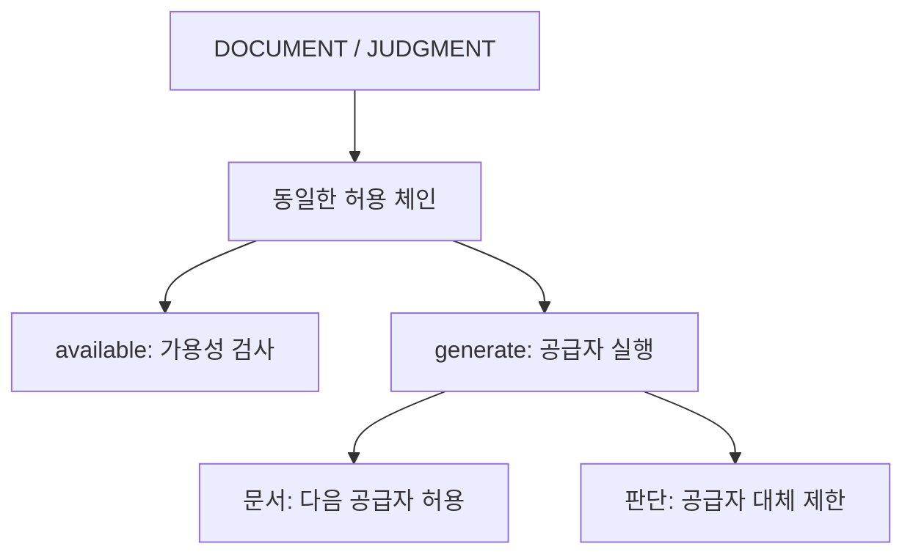
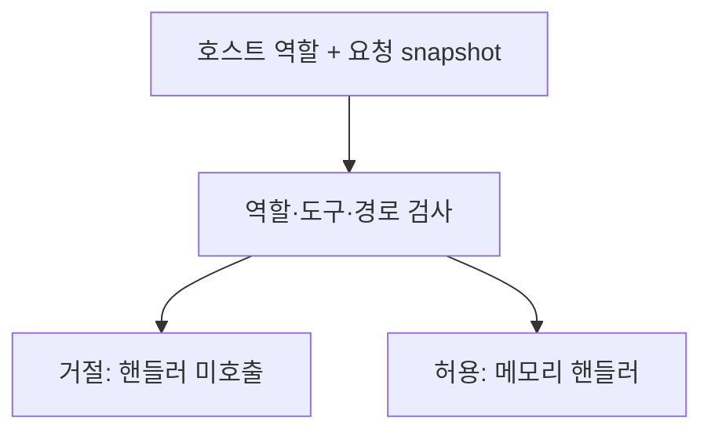

# SafeLedger Engineering Cases

**LLM 호출 추상화·실패 정책 / Coding Agent 역할·도구 경계**

SafeLedger | 산업안전 관리·AI 판단 보조 시스템은 법령 검색·안전관리 기록·문서 초안·AI 판단 보조를 다루는 프로젝트입니다. 이 저장소는 그 문제를 설명하는 **독립 최소 재현 예제 두 개**이며 원본 제품 코드·설정·데이터·테스트를 포함하지 않습니다.

> 공개 범위는 프로젝트명·일반 기능 소개와 독립 예제·문서·테스트 결과입니다. 원본·팀 비공개 자료·미확인 성과 자료는 포함하지 않습니다.

## 바로 보기

| 사례 | 설계·판단 | 구현 | 테스트 | 실행·한계 |
|---|---|---|---|---|
| LLM Gateway | [용도별 라우팅과 실패 정책](cases/a-safeledger-llm.md) | [LlmGateway.java](examples/llm-gateway/src/LlmGateway.java) | [15개 회귀 테스트](examples/llm-gateway/tests/LlmGatewayTest.java) | [Java 예제 README](examples/llm-gateway/README.md) |
| Coding Agent Guardrails | [역할·권한과 호출 경계](cases/c-safeledger-agent.md) | [guard.mjs](examples/agent-guardrails/guard.mjs) | [20개 합성 테스트](examples/agent-guardrails/guard.test.mjs) | [JavaScript 예제 README](examples/agent-guardrails/README.md) |

**예제 기술:** Java/JDK 17+, JavaScript/Node.js 18+, Python 3.10+ 컴파일 러너. 외부 패키지·API 키·네트워크가 필요하지 않습니다.

## 예제 아키텍처와 핵심 구현

LLM Gateway는 `Provider` 경계와 하나의 `permittedChain()`을 둡니다. 가용성 검사와 실행이 같은 정책을 따르고 문서는 대체를 허용하지만 판단은 첫 공급자로 제한합니다. 선언된 공급자 장애만 폴백 대상으로 삼고 프로그래밍 오류는 전파합니다.



Guardrails는 셸 문자열이 아니라 역할·도구·상대 경로를 검사합니다. 호스트 역할과 immutable 요청을 고정해 거절된 요청이 핸들러에 도달하지 않게 합니다.



## 실행

모든 명령은 이 저장소 루트에서 실행합니다.

```sh
python -B examples/llm-gateway/run.py
node --test examples/agent-guardrails/guard.test.mjs
```

데모:

```sh
python -B examples/llm-gateway/run.py --demo
node examples/agent-guardrails/demo.mjs
```

Java는 임시 폴더에서 컴파일한 뒤 정리합니다. Guardrails는 메모리 핸들러만 호출하며 실제 파일 쓰기·삭제·push·셸 실행은 하지 않습니다.

## 검증 결과

분리 후 테스트를 실행해 **Java 15/15, JavaScript 20/20 — 총 35건 통과, 실패·skip 0건**을 확인했습니다. [결과·환경·실행 파일 식별](evidence/test-results.md)에 기록했습니다. 이는 새 예제의 합성 테스트이며 실제 LLM 품질이나 원본 제품의 성과가 아닙니다.

## 기여와 자료 범위

이 자료는 기술적 선택을 실행 코드와 별도 테스트로 설명합니다. 예제 개발·자동화된 검증에는 Coding Agent를 활용했습니다. 원본에서 지원자가 결정한 정책, 팀원 구현, Agent 구현의 관계를 예제 작성으로 바꾸지 않습니다. 공개 허용이 미확인인 원본 개인 기여 상세·팀 자료·성과·수상 증빙은 기재하지 않았습니다.

실제 공급자·모델 비교, 비용·운영 가용성, OS sandbox는 검증하지 않습니다. 훅은 호출 경로의 검사이며 실제 OS 권한 격리와 다릅니다. [근거 기준](evidence/README.md)과 [공개 범위](docs/publication-scope.md)를 확인할 수 있습니다.

```sh
python -B tools/check_repository.py
```

<!-- 공개 권리와 실제 파일을 확인한 PDF가 생기면 이 위치에 링크를 추가한다. 현재 PNG·PDF·임시 URL은 없다. -->
