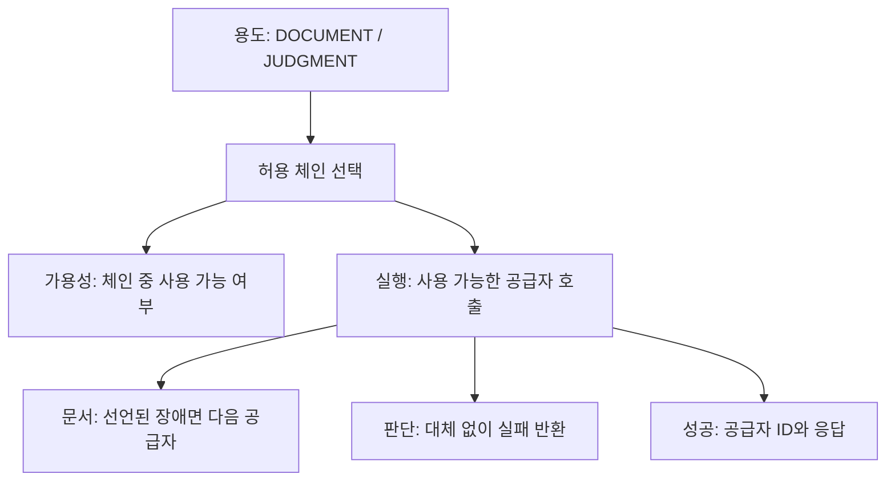

# A. SafeLedger — LLM Gateway & Model Evaluation

SafeLedger는 법령 검색·안전관리 기록·문서 초안·AI 판단 보조를 다루는 프로젝트입니다. 아래 구조와 코드는 **독립 예제**이며 원본 구조·성능·실행 성공을 증명하지 않습니다.

## 문제와 판단

실행에는 대체 공급자가 있어도 가용성 검사가 첫 공급자만 보면 기능을 차단할 수 있습니다. 반대로 판단 용도에 문서 생성과 같은 폴백을 허용하면 판단 주체가 바뀝니다.

예제는 `Provider` 계약과 `permittedChain()`을 두고 가용성·실행이 같은 체인을 사용합니다. 문서는 대체를 허용하고 판단은 첫 공급자로 제한합니다. 장애도 선언된 공급자 실패와 프로그래밍 오류로 나눕니다.

## 구현과 재현

- [구현](../examples/llm-gateway/src/LlmGateway.java): 목적별 정책·공급자 계약·타입별 실패 처리.
- [테스트](../examples/llm-gateway/tests/LlmGatewayTest.java): 첫 공급자 불가·장애·판단 제한의 호출 횟수.
- [실행 방법과 범위](../examples/llm-gateway/README.md).

첫 공급자 불가·두 번째 정상에서 문서 가용성은 true, 실제 응답은 두 번째 공급자입니다. 같은 설정의 판단 가용성은 false이며 두 번째 공급자는 호출하지 않습니다. 합성 테스트15건의 결과는 [로컬 기록](../evidence/test-results.md)에 있습니다.

## 모델 비교는 다른 검증이다

이 예제는 실제 모델을 비교하지 않습니다. 실제 비교를 공개할 때는 코드·모델·프롬프트·질문셋·검색 조건·임베딩·반복 횟수와 분모를 고정해야 합니다.

가용성 테스트는 품질 평가가 아닙니다. 기대 조문이 답변에 있는지 검색 근거에도 있는지, 무응답이 생성 모델인지 검색 게이트 때문인지 구별합니다. 캐시 응답은 새 생성과 분리하고 Agent 실행별 멱등키로 이전 결과 재사용을 확인합니다. 원본 비교 집계는 공개 권리가 미확인이라 포함하지 않습니다.

## 기여·한계

새 예제의 설계와 실행 결과를 제공합니다. 원본의 팀·지원자·Coding Agent 기여와 상세 기록은 별도로 확인합니다. 실제 API 장애·모델 품질·비용·운영 가용성은 검증하지 않았습니다.

[보조 검증 기준](../evidence/README.md) · [목록](../README.md)
