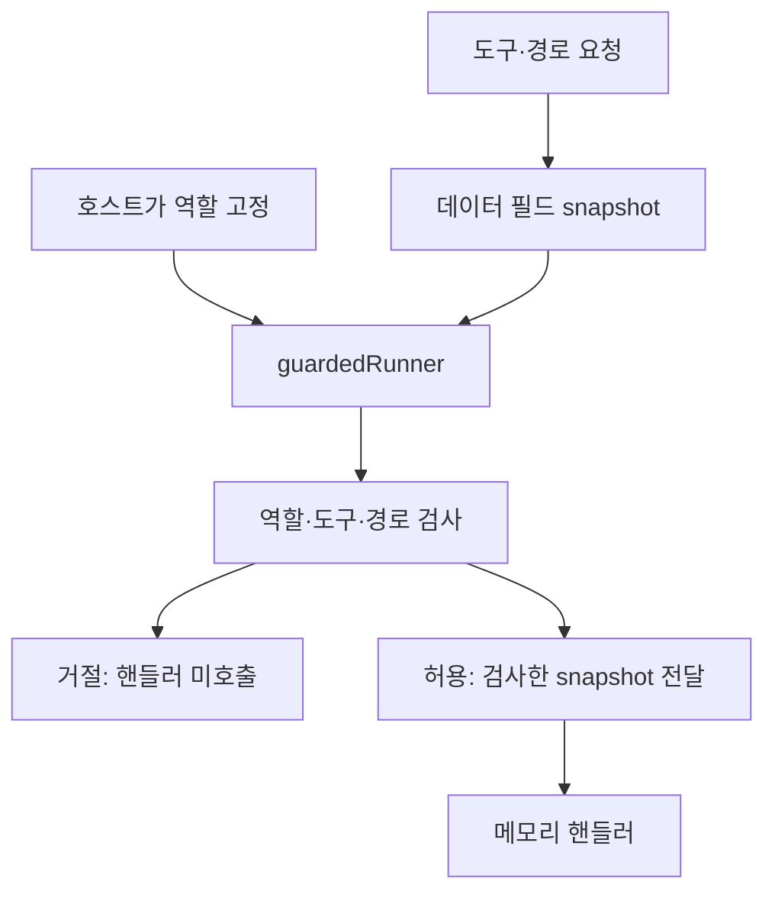

# C. SafeLedger — Coding Agent Engineering

SafeLedger의 Coding Agent 개발 환경을 기술적 배경으로 삼은 **독립 도구 정책 예제**입니다. 원본 훅·운영 정책·우회 명령을 복사하지 않았습니다.

## 문제와 판단

문자열의 위험 단어만 보면 배포 문서를 읽는 정상 요청을 막으면서 무해한 파일 이름의 쓰기는 놓칠 수 있습니다. 예제는 셸을 해석하지 않고 도구명·역할·상대 경로를 구조화된 계약으로 검사합니다.

## 구현과 재현

- [구현](../examples/agent-guardrails/guard.mjs): 역할 정책·경로 검사·호출 전 가드.
- [테스트](../examples/agent-guardrails/guard.test.mjs): 오탐·누락·역할 위장·핸들러 연결.
- [실행 방법과 범위](../examples/agent-guardrails/README.md).

배포·삭제 단어가 있는 파일 읽기는 허용합니다. 감사 역할의 쓰기와 요청 필드의 역할 승격은 거절하며 핸들러를 호출하지 않습니다. 접근자로 검사 후 도구를 바꾸는 요청도 거절합니다. 합성 테스트20건의 결과는 [로컬 기록](../evidence/test-results.md)에 있습니다.

## 독립 검증과 권한 통제

수정 로직과 테스트를 분리해 허용·거절·검사 누락을 각각 검사합니다. 여기서 독립 검증은 별도 테스트를 뜻하며 원본의 특정 사람·Agent 검수 행위를 입증하지 않습니다.

훅은 해당 호출 경로의 정책입니다. OS 계정 권한·격리와 같지 않으며 직접 핸들러 호출이나 파일시스템 링크의 실제 대상까지 차단하지 않습니다. 실제 도구 연결 시 호스트가 경로를 안전하게 해석하고 OS 권한을 별도로 제한해야 합니다.

## 기여·한계

원본의 정책 결정, 팀원·Coding Agent 구현, 검수 행위를 재귀속하지 않습니다. 임의 셸 실행·자격 경계·OS sandbox는 구현하지 않습니다. 합성 입력의 정책과 핸들러 연결만 검증합니다.

[보조 검증 기준](../evidence/README.md) · [목록](../README.md)
